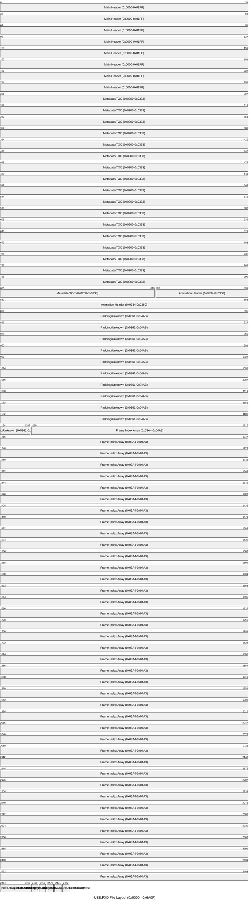
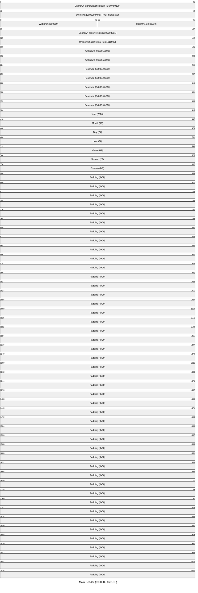
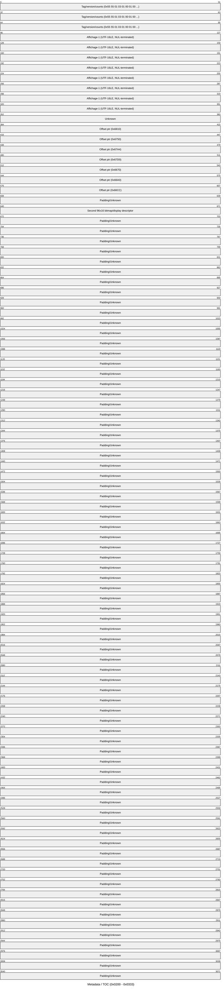
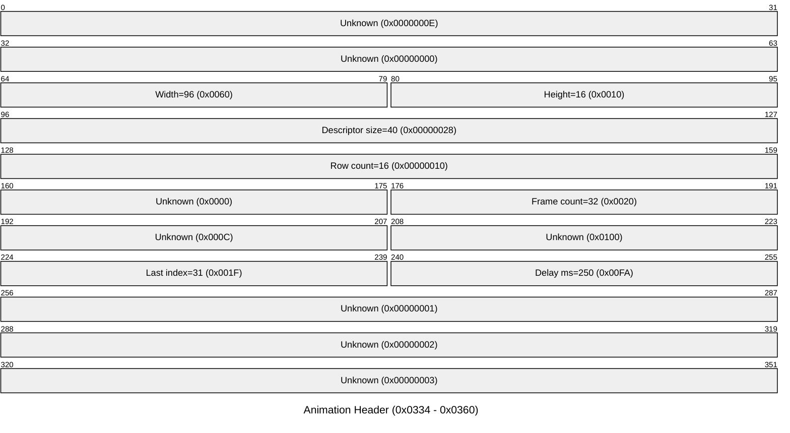
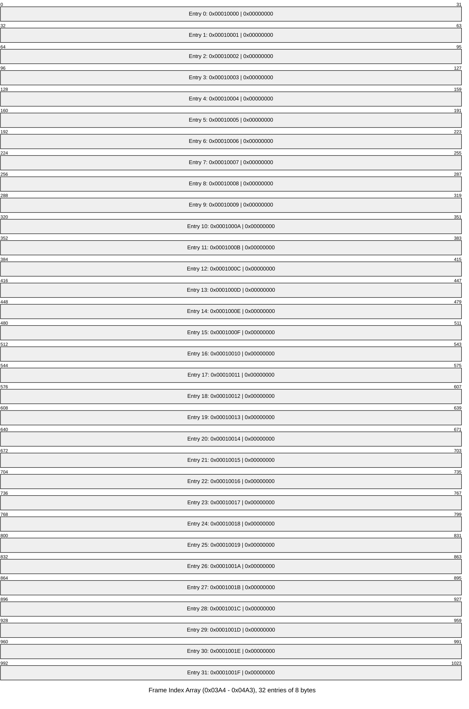
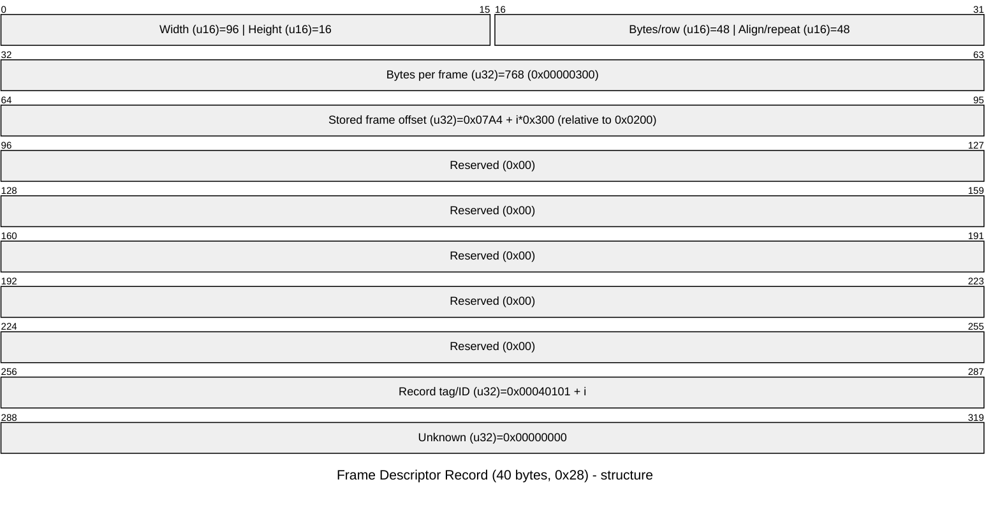
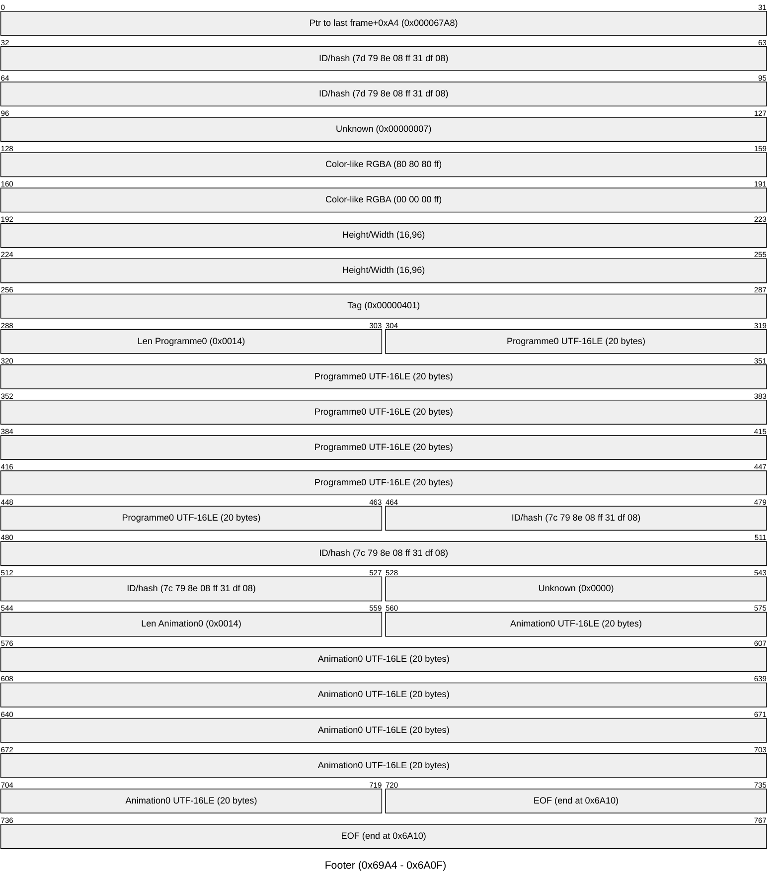

# USB.FXD Format Specification

## Overview

USB.FXD is a binary format for 96×16 LED-panel animations. Pixels are stored as
4-bit palette indices (two pixels per byte). In the observed sample only palette
indices `0–7` occur, even though the companion GIF has a 16-color table.

| Property                | Value                                               |
|-------------------------|-----------------------------------------------------|
| Dimensions              | 96 (width) × 16 (height) pixels                     |
| Pixel storage           | 4 bits per pixel, two pixels per byte (4bpp packed) |
| Endianness              | Little-endian                                       |
| File type               | Custom binary format; no ASCII magic at start       |
| Frame count (sample)    | 32                                                  |
| Frame size (sample)     | 768 bytes (`0x300`) per frame                       |
| Frame duration (sample) | 250 ms (global)                                     |
| File size (sample)      | `0x6A10` (27,152 bytes)                             |

## File Layout Summary



| Section                | Start    | End      | Size             | Notes                                                             |
|------------------------|----------|----------|------------------|-------------------------------------------------------------------|
| Main Header            | `0x0000` | `0x01FF` | `0x200` (512)    | Dimensions, flags, timestamp. No frame count/size.                |
| Metadata / TOC         | `0x0200` | `0x0333` | `0x134` (308)    | Display objects, `"Affichage-1"`. Contains preview offsets.       |
| Animation Header       | `0x0334` | `0x0360` | `0x2D` (45)      | Contains frame count, last index, delay.                          |
| (Padding/unknown)      | `0x0361` | `0x04AB` | `0x14B` (331)    | Mostly zeroed.                                                    |
| Frame Index Array      | `0x03A4` | `0x04A3` | `0x100` (256)    | 32 × 8-byte entries (see below).                                  |
| Marker                 | `0x04A4` | `0x04A7` | 4                | `0x00040100`                                                      |
| (Padding)              | `0x04A8` | `0x04AB` | 4                | Zero                                                              |
| Frame Descriptor Table | `0x04AC` | `0x09A3` | `0x4F8` (1272)   | 32 × 40-byte (`0x28`) records. Last record has no 8-byte trailer. |
| Frame Data             | `0x09A4` | `0x69A3` | `0x6000` (24576) | 32 × 768-byte frames, 4bpp packed.                                |
| Footer                 | `0x69A4` | `0x6A0F` | `0x6C` (108)     | Bitmap/object fields, `"Programme0"`, `"Animation0"`.             |

## 1) Main Header (0x0000–0x01FF)



| Offset       | Size    | Type   | Value (sample)                      | Meaning                               |
|--------------|---------|--------|-------------------------------------|---------------------------------------|
| `0x00`       | 4       | u32/le | `0x00A80139` (`39 01 a8 00`)        | Unknown signature/checksum            |
| `0x04`       | 4       | u32/le | `0x00000A00` (`00 0A 00 00`) = 2560 | Unknown; **not** the frame-data start |
| `0x08`       | 2       | u16/le | `0x0060` = 96                       | Width                                 |
| `0x0A`       | 2       | u16/le | `0x0010` = 16                       | Height                                |
| `0x0C`       | 4       | u32/le | `0x00003201` (`01 32 00 00`)        | Unknown flags/version                 |
| `0x10`       | 4       | u32/le | `0x01011002` (`02 10 01 01`)        | Unknown flags/format fields           |
| `0x14`       | 4       | u32/le | `0x00010000`                        | Unknown                               |
| `0x18`       | 4       | u32/le | `0x00550000`                        | Unknown                               |
| `0x1C–0x2F`  | 20      | —      | `0x00`                              | Reserved                              |
| `0x30`       | 4       | u32/le | `2026`                              | Year                                  |
| `0x34`       | 4       | u32/le | `10`                                | Month                                 |
| `0x38`       | 4       | u32/le | `24`                                | Day                                   |
| `0x3C`       | 4       | u32/le | `18`                                | Hour                                  |
| `0x40`       | 4       | u32/le | `46`                                | Minute                                |
| `0x44`       | 4       | u32/le | `27`                                | Second                                |
| `0x48`       | 4       | u32/le | `0`                                 | Reserved                              |
| `0x4C–0x1FF` | `0x1B4` | —      | `0x00`                              | Padding                               |

**Notes:**
- Offsets `0x30–0x47` form the timestamp. Sample: **2026-10-24 18:46:27**.
- `0x04` is close to the frame buffer but does **not** point to frame data; do not use it as the frame-data offset.
- Frame count and per-frame size are **not** in this header (see Animation Header and Descriptor Table).

## 2) Metadata / TOC (0x0200–0x0333)



| Offset  | Size | Type       | Value (sample)                        | Meaning                                        |
|---------|------|------------|---------------------------------------|------------------------------------------------|
| `0x200` | 12   | raw        | `55 55 01 03 01 00 01 00 01 00 01 00` | Record tag/version/counts                      |
| `0x20C` | ~28  | UTF-16LE/Z | `"Affichage-1"` (NUL-terminated)      | Display object name                            |
| `0x228` | 4    | u32/le     | `0x00006810`                          | Pointer into frame-data area (preview/display) |
| `0x238` | 4    | u32/le     | `0x00006750`                          | Pointer into frame-data area (preview/display) |
| `0x240` | 4    | u32/le     | `0x000067A4`                          | Pointer into frame-data area (preview/display) |
| `0x248` | 4    | u32/le     | `0x000067D0`                          | Pointer into frame-data area (preview/display) |
| `0x250` | 4    | u32/le     | `0x00006670`                          | Pointer into frame-data area (preview/display) |
| `0x254` | 4    | u32/le     | `0x000066A0`                          | Pointer into frame-data area (preview/display) |
| `0x2CC` | 4    | u32/le     | `0x000066CC`                          | Pointer into frame-data area (preview/display) |
| `0x2C0` | 40   | struct     | 96×16 bitmap/display descriptor       | Second display descriptor (see pattern)        |

**Notes:** Pointers at `0x228/0x238/0x240/0x248/0x250/0x254/0x2CC` reference the frame-data region but describe display/preview regions, not animation frames. Names `"Programme0"` and `"Animation0"` appear near EOF in the footer as length-prefixed UTF-16LE strings.

## 3) Animation Header (0x0334–0x0360)



| Offset  | Size | Type   | Value (sample)      | Meaning                               |
|---------|------|--------|---------------------|---------------------------------------|
| `0x334` | 4    | u32/le | `14` (`0x0000000E`) | Unknown (possibly record type/length) |
| `0x338` | 4    | u32/le | `0`                 | Unknown                               |
| `0x33C` | 2    | u16/le | `96` (`0x0060`)     | Width                                 |
| `0x33E` | 2    | u16/le | `16` (`0x0010`)     | Height                                |
| `0x340` | 4    | u32/le | `40` (`0x28`)       | Size of one frame-descriptor record   |
| `0x344` | 4    | u32/le | `16`                | Row count                             |
| `0x348` | 2    | u16/le | `0`                 | Unknown                               |
| `0x34A` | 2    | u16/le | **`32`**            | **Frame count**                       |
| `0x34C` | 2    | u16/le | `12`                | Unknown                               |
| `0x34E` | 2    | u16/le | `256` (`0x0100`)    | Unknown                               |
| `0x350` | 2    | u16/le | **`31`**            | **Last frame index (0-based)**        |
| `0x352` | 2    | u16/le | **`250`**           | **Frame duration in ms (global)**     |
| `0x354` | 4    | u32/le | `1`                 | Unknown                               |
| `0x358` | 4    | u32/le | `2`                 | Unknown                               |
| `0x35C` | 4    | u32/le | `3`                 | Unknown                               |

The `250` ms value matches the GIF (all frames 0.25 s). USB.FXD stores one global delay for the whole animation.

## 4) Frame Directory

### 4a) Index array at 0x03A4 (32 × 8 bytes)



| Offset                | Size | Type   | Value (sample)                        | Meaning                      |
|-----------------------|------|--------|---------------------------------------|------------------------------|
| `0x03A4 + i*8 + 0x00` | 4    | u32/le | `0x00010000 + i` (`0x10000..0x1001F`) | Entry tag/index              |
| `0x03A4 + i*8 + 0x04` | 4    | u32/le | `0`                                   | Unknown                      |
| `0x04A4`              | 4    | u32/le | `0x00040100`                          | Marker following index array |

### 4b) Descriptor table at 0x04AC (32 × 40 bytes, `0x28`)

Descriptor `i` starts at `0x04AC + i*0x28`. The last descriptor has **no separate 8-byte trailer**; its `+0x20` area coincides with the start of frame data at `0x09A4`.



| Record offset | Size | Type   | Value (sample)           | Meaning                                   |
|---------------|------|--------|--------------------------|-------------------------------------------|
| `+0x00`       | 2    | u16/le | `96` (`0x0060`)          | Width                                     |
| `+0x02`       | 2    | u16/le | `16` (`0x0010`)          | Height                                    |
| `+0x04`       | 2    | u16/le | `48` (`0x0030`)          | Bytes per row (96 pixels / 2 pixels/byte) |
| `+0x06`       | 2    | u16/le | `48` (`0x0030`)          | Repeat/alignment value                    |
| `+0x08`       | 4    | u32/le | **`768`** (`0x00000300`) | **Bytes per frame**                       |
| `+0x0C`       | 4    | u32/le | `0x07A4 + i*0x300`       | Frame-data offset (stored)                |
| `+0x10–0x1F`  | 16   | —      | `0x00`                   | Reserved                                  |
| `+0x20`       | 4    | u32/le | `0x00040101 + i`         | Record tag/ID                             |
| `+0x24`       | 4    | u32/le | `0`                      | Unknown                                   |

**Offset conversion:**
```text
actual_offset = stored_offset + 0x0200
```

| i   | Stored at `+0x0C` | Actual file offset |
|-----|-------------------|--------------------|
| 0   | `0x07A4`          | `0x09A4`           |
| 1   | `0x0AA4`          | `0x0CA4`           |
| ... | ...               | ...                |
| 31  | `0x64A4`          | `0x66A4`           |

**Layout detail:** The 32 descriptors take 32×40 = 1280 bytes total (`0x04AC`–`0x09AB`), but the last descriptor’s bytes from `+0x20` onward overlap with frame data. Practically: 31 full descriptors + 32-byte header of descriptor 31 are followed immediately by frame data at `0x09A4` (which is at `descriptor31 + 0x20`).

## 5) Frame Data (0x09A4–0x69A3)


| Property       | Value                                                |                        |                                                                                                                   |
|----------------|------------------------------------------------------|------------------------|-------------------------------------------------------------------------------------------------------------------|
| Start          | `0x09A4`                                             |                        |                                                                                                                   |
| End            | `0x69A4` (exclusive of footer start)                 |                        |                                                                                                                   |
| Count          | 32                                                   |                        |                                                                                                                   |
| Size per frame | 768 bytes (`0x300`) = 16 rows × 48 bytes             |                        |                                                                                                                   |
| Row size       | 48 bytes = 96 pixels @ 4 bits/pixel                  |                        |                                                                                                                   |
| Packing        | 2 pixels per byte (4bpp). Each byte = `(pix1 << 4) \ | pix0` or `(pix0 << 4)\ | pix1` depending on convention; in sample both nibbles equal (`0x00,0x11,...,0x77`) so order not directly visible. |
| Total          | 32 × 768 = 24576 bytes = `0x6000`                    |                        |                                                                                                                   |

### Frame 0 decode (offset `0x09A4`)

| Row | Pattern (96 pixels) | Notes        |
|-----|---------------------|--------------|
| 0   | `0 × 96`            | Black        |
| 1   | `0 × 96`            | Black        |
| 2   | `7 × 96`            | Yellow       |
| 3   | `7 × 96`            | Yellow       |
| 4   | `1 × 96`            | Dark gray    |
| 5   | `1 × 96`            | Dark gray    |
| 6   | `1 × 96`            | Dark gray    |
| 7   | `3 × 96`            | White        |
| 8   | `2 × 96`            | Light gray   |
| 9   | `2 × 96`            | Light gray   |
| 10  | `6 × 96`            | Brown/orange |
| 11  | `6 × 96`            | Brown/orange |
| 12  | `4 × 96`            | Dark red     |
| 13  | `4 × 96`            | Dark red     |
| 14  | `5 × 96`            | Light red    |
| 15  | `5 × 96`            | Light red    |

**Notes:**
- The first 96 bytes (`0x09A4–0x0A03`) correspond to rows 0–1 (black). This region overlaps with the last descriptor’s unused 8-byte trailer area.
- Animation is a vertical scroll: each subsequent frame is the previous frame shifted up by one row, wrapping around.
- Frame 1 starts at `0x0CA4`.

## 6) Footer (0x69A4–0x6A0F, 0x6C bytes)



| Offset   | Size | Type     | Value (sample)            | Meaning                                    |
|----------|------|----------|---------------------------|--------------------------------------------|
| `0x69A4` | 4    | u32/le   | `0x67A8`                  | Pointer into last frame (`frame31 + 0xA4`) |
| `0x69A8` | 8    | raw      | `7d 79 8e 08 ff 31 df 08` | ID/hash-like value                         |
| `0x69B0` | 4    | u32/le   | `7`                       | Unknown                                    |
| `0x69B4` | 4    | raw      | `80 80 80 ff`             | Color-like value (RGBA)                    |
| `0x69B8` | 4    | raw      | `00 00 00 ff`             | Color-like value (RGBA)                    |
| `0x69C0` | 2    | u16/le   | `16`                      | Height                                     |
| `0x69C2` | 2    | u16/le   | `96`                      | Width                                      |
| `0x69C8` | 2    | u16/le   | `16`                      | Height                                     |
| `0x69CA` | 2    | u16/le   | `96`                      | Width                                      |
| `0x69CC` | 4    | u32/le   | `0x00000401`              | Tag                                        |
| `0x69DA` | 2    | u16/le   | `0x0014`                  | Byte length of `"Programme0"`              |
| `0x69DC` | 20   | UTF-16LE | `"Programme0"`            | Object name                                |
| `0x69F0` | 8    | raw      | `7c 79 8e 08 ff 31 df 08` | ID/hash-like value                         |
| `0x69F8` | 2    | u16/le   | `0`                       | Unknown                                    |
| `0x69FA` | 2    | u16/le   | `0x0014`                  | Byte length of `"Animation0"`              |
| `0x69FC` | 20   | UTF-16LE | `"Animation0"`            | Object name                                |
| `0x6A10` | —    | —        | EOF                       | End of file                                |

## Decoding Recipe

```text
width       = u16 at 0x08
height      = u16 at 0x0A
count       = u16 at 0x34A
delay_ms    = u16 at 0x352        # global
row_bytes   = u16 at descriptor0 + 0x04  # 48
frame_bytes = u32 at descriptor0 + 0x08  # 768
first_frame = descriptor0_offset + 0x200 # 0x09A4

for i in 0..count:
    descriptor = 0x04AC + i*0x28
    stored     = u32 at descriptor + 0x0C
    frame_off  = stored + 0x200
    for y in 0..height:
        row = data[frame_off + y*row_bytes .. frame_off + (y+1)*row_bytes]
        for b in row:
            emit(b >> 4)
            emit(b & 0x0F)
```

## Palette

The related GIF uses this 16-color table. USB.FXD stores palette indices only; no explicit 16-entry RGB palette table was found in the examined sections. Only indices `0–7` occur in this sample.

| Index | Color         | RGB       |
|-------|---------------|-----------|
| 0     | Black         | `#000000` |
| 1     | Dark gray     | `#555555` |
| 2     | Light gray    | `#aaaaaa` |
| 3     | White         | `#ffffff` |
| 4     | Dark red      | `#aa0000` |
| 5     | Light red     | `#ff5555` |
| 6     | Brown/orange  | `#aa5500` |
| 7     | Yellow        | `#ffff55` |
| 8     | Dark green    | `#00aa00` |
| 9     | Light green   | `#55ff55` |
| 10    | Cyan          | `#00aaaa` |
| 11    | Light cyan    | `#55ffff` |
| 12    | Dark blue     | `#0000aa` |
| 13    | Light blue    | `#5555ff` |
| 14    | Magenta       | `#aa00aa` |
| 15    | Light magenta | `#ff55ff` |

## Implementation Notes

`ledfx_editor/src/export.rs` implements this layout:

- Importer reads count from `0x34A`, delay from `0x352`, and frame offsets from the descriptor table (`stored + 0x200`).
- Exporter writes a fixed 32-slot file (`0x6A10` bytes). Animations with fewer than 32 frames repeat the last frame in unused slots; animations with more than 32 frames are rejected.
- Exporter uses the first frame's duration as the file-wide delay field (USB.FXD stores one global delay).
- Round-trip test confirms importing the observed `USB.FXD` and exporting it again preserves metadata, descriptors, all 32 frames, and the footer.

### Corrected frame-0 decode (offset 0x09A4)

Frame 0 is 16 rows of 96 pixels:

```text
Row  0: 0 × 96
Row  1: 0 × 96
Row  2: 7 × 96
Row  3: 7 × 96
Row  4: 1 × 96
Row  5: 1 × 96
Row  6: 1 × 96
Row  7: 3 × 96
Row  8: 2 × 96
Row  9: 2 × 96
Row 10: 6 × 96
Row 11: 6 × 96
Row 12: 4 × 96
Row 13: 4 × 96
Row 14: 5 × 96
Row 15: 5 × 96
```

The first 96 bytes of the frame (`0x09A4–0x0A03`) are zero, i.e. two black
rows. This region also contains the last descriptor's unused 8-byte trailer;
because the rows are black and the trailer is not required for the final record,
the two regions coexist.

Frame 1 begins at `0x0CA4`. The animation is a vertical scroll: each frame is
the previous frame shifted up by one row, with the sequence wrapping around.

## Footer (0x69A4–0x6A0F)

The footer is 108 bytes (`0x6C`):

| Offset | Size    | Value                     | Meaning                                        |
|--------|---------|---------------------------|------------------------------------------------|
| 0x69A4 | u32     | `0x67A8`                  | Pointer into the last frame (`frame31 + 0xA4`) |
| 0x69A8 | 8       | `7d 79 8e 08 ff 31 df 08` | ID/hash-like value                             |
| 0x69B0 | u32     | `7`                       | Unknown                                        |
| 0x69B4 | 4       | `80 80 80 ff`             | Colour-like value                              |
| 0x69B8 | 4       | `00 00 00 ff`             | Colour-like value                              |
| 0x69C0 | u16,u16 | `16, 96`                  | Height, width                                  |
| 0x69C8 | u16,u16 | `16, 96`                  | Height, width                                  |
| 0x69CC | u32     | `0x00000401`              | Tag                                            |
| 0x69DA | u16     | `0x0014`                  | Byte length of `"Programme0"`                  |
| 0x69DC | 20      | UTF-16LE `"Programme0"`   | Object name                                    |
| 0x69F0 | 8       | `7c 79 8e 08 ff 31 df 08` | ID/hash-like value                             |
| 0x69F8 | u16     | `0`                       | —                                              |
| 0x69FA | u16     | `0x0014`                  | Byte length of `"Animation0"`                  |
| 0x69FC | 20      | UTF-16LE `"Animation0"`   | Object name                                    |
| 0x6A10 | —       | EOF                       | —                                              |

## Decoding Recipe

```text
width       = u16 at 0x08
height      = u16 at 0x0A
count       = u16 at 0x34A
delay_ms    = u16 at 0x352
row_bytes   = u16 at descriptor0 + 0x04      # 48
frame_bytes = u32 at descriptor0 + 0x08      # 768
first_frame = descriptor0_offset + 0x200     # 0x9A4

for i in 0..count-1:
    descriptor = 0x4AC + i*0x28
    stored     = u32 at descriptor + 0x0C
    frame_off  = stored + 0x200
    for y in 0..height-1:
        row = data[frame_off + y*row_bytes : frame_off + (y+1)*row_bytes]
        for byte in row:
            emit(byte >> 4)
            emit(byte & 0x0F)
```

## Encoding B Is Not a Separate Encoding

The apparent ASCII data in the frame area (`0x00`, `0x11`, `0x22`, … `0x77`,
sometimes shown as characters such as `w`, `3`, `f`, `D`) is simply packed 4-bit
pixel data. Each byte contains two identical palette indices in this sample.

## Palette

The related GIF uses this 16-color table:

```text
0: #000000 (black)
1: #555555 (dark gray)
2: #aaaaaa (light gray)
3: #ffffff (white)
4: #aa0000 (dark red)
5: #ff5555 (light red)
6: #aa5500 (brown/orange)
7: #ffff55 (yellow)
8: #00aa00 (dark green)
9: #55ff55 (light green)
10: #00aaaa (cyan)
11: #55ffff (light cyan)
12: #0000aa (dark blue)
13: #5555ff (light blue)
14: #aa00aa (magenta)
15: #ff55ff (light magenta)
```

USB.FXD stores palette indices. No explicit 16-entry RGB palette table was
found in the sections examined. Only indices 0–7 occur in this sample.

## File Structure Summary

1. **Main header** (0x0000–0x004B): dimensions, flags, timestamp.
2. **Padding** (0x004C–0x01FF).
3. **Metadata/TOC** (0x0200–0x0333): display objects and `"Affichage-1"`.
4. **Animation header** (0x0334–0x0360): width/height, descriptor size, frame
   count (32), last index (31), frame delay (250 ms).
5. **Frame index array** (0x03A4–0x04A3): 32 entries.
6. **Frame descriptor table** (0x04AC–0x09A3): 32 × 40-byte records; the last
   record has no trailer because frame data starts at its trailer position.
7. **Frame data** (0x09A4–0x69A3): 32 × 768-byte 4bpp frames.
8. **Footer** (0x69A4–0x6A0F): bitmap/object fields and the names
   `"Programme0"`, `"Animation0"`.

## Implementation Notes

`ledfx_editor/src/export.rs` implements this layout:

- The importer reads the count from `0x34A`, the delay from `0x352`, and frame
  offsets from the descriptor table (`stored + 0x200`).
- The exporter writes a fixed 32-slot file (`0x6A10` bytes). Animations with
  fewer than 32 frames repeat the last frame in the unused slots; animations with
  more than 32 frames are rejected.
- The exporter uses the first frame's duration as the file-wide 250 ms-style
  delay field, since USB.FXD stores one delay for the whole animation.
- A round-trip test confirms that importing the observed `USB.FXD` and exporting
  it again preserves all metadata, descriptors, all 32 frames, and the footer.
